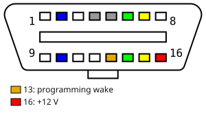

# M5.9.2 — KWP protocol

The write sequence is in `Communication/FirstWakeFlash.cs`. User steps are in [Bootmode](user-guide/bootmode.md#m592). ME7 connect, session, and RAM-kernel notes are in [KWP2000.md](KWP2000.md). Those session bytes are from C167 images and do not describe this ECU.

Support covers a 558P flashed to 558M only.

This ECU is an 80C196. The programming session handler is in OTP. The flash image does not compare session `0x85` or security service `0x27`. The app Boot Mode screen is the C167 bootstrap loader. The hello on that screen is a cable echo.

Wake and the programming session run at 10400 until a speed byte moves the ECU.

## Pin 43

Pin 43 is the programming wake. In the car the usual OBD pin is 13: bridging it to pin 16 (+12 V) holds the wake high. VW looms often wire pin 13. Many Audi looms leave it empty, and the wire can be added. Some OBD cables can drive that pin high. This app does not. Pin 7 is the ME7 K-line. The app cannot see pin 43.

13: programming wake. 16: +12 V. Bridging 13 to 16 holds the wake high.

| Pin 43 | What answers |
| --- | --- |
| +12 V | First wake is KWP2000. Key bytes `0x6F` / `0x0F`. Full Write uses this wake. |
| Off +12 V | Held KWP1281 at slow init `0x01`. Key bytes `0x01` / `0x0A`. Full Read copies calibration `0x0000`–`0xBFFF`. EEPROM read copies the 24C02. DTC read is block title `0x07`. Clear is `0x05`, and only after a read has answered. |

ME7 KWP2000 stores the same key bytes once the parity bit is masked ([ME7 K-line addresses](ME7-K-line-addresses.md)). Calibration ident `1A 9B`, or any ident that contains `ME7`, keeps the ME7 path when it does not contain `M5.9`. Tester present stays on, and Full Read and Full Write stay the ME7 operations. A software number alone does not.

Fast init at `0x11` with pin 43 off +12 V gets no reply. That is a dead wake, not a silent speed byte.

## Addresses

| Use | Address | Result |
| --- | --- | --- |
| Connect scan | `0x10` fast init | No reply. The scan continues. |
| Connect | `0x01` fast init | KWP2000 when pin 43 is at +12 V. |
| Full Write | `0x11` fast init | Programming wake. Target byte in the write frames is `0x11`. |
| Held read | `0x01` slow init | KWP1281 when pin 43 is off +12 V. |

## Write order

The connect-bar baud picks one speed byte. At 38400 or higher the byte is `0x50`. Below that it is `0x14`. One byte is sent. A refusal stops the write.

1. Fast init at `0x11`, then StartCommunication.
2. `1A 95`, `1A 9B`, `1A 9C`.
3. `10 85` plus the speed byte, before the security key. The request and the positive reply are at 10400. After `50 85` for `0x50`, the tester switches to 38400.
4. `83 00` reads the timing limits.
5. `31 C4` erases `0` through `length - 1`, with trailer `00 01 01 0A 81 FE`.
6. Erase `7F 31 33` sends security `27 01`. The key is five rounds of polynomial `0x18932250`. The mode byte is the seed's access mode plus one.
7. The same `10 85` speed byte is sent again, then `83 00`, then `31 C4` again. Erase is not the next frame after the key.
8. Poll `33 C4` until `73 C4`.
9. `34` download, format `0x11`, address `0x600000`, length of the file.
10. `36` blocks. The image is Bosch-compressed. A leading `1A 01` is skipped. The rest is XORed with the repeating key `DISPOSITION`.
11. `37` transfer exit after the last block.
12. `31 C5` checksum of the prepared file, low 16 bits. Poll `33 C5` until `73 C5`.

A session reply of `7F 10 33` uses the level-1 polynomial `0x5FBD5DBD` instead, then sends the session again.

A silent speed byte stops the write. The app does not send ECU reset `11 01` or `82` StopCommunication, and does not retry that power-on.

## Speed byte

Bosch encoding `XXXYYYYY`. Baud is `2^X * (Y + 32) * 200`. Implemented as `StartDiagnosticSessionAction.CalculateBaudRateFromByte`. Fiat's third-byte table (`01` = 9600 through `05` = 115200) is a different encoding.

| Byte | Baud | `10 85` before the key |
| --- | --- | --- |
| `0x14` | 10400 | Accepted. `50 85`. The port stays at 10400. |
| `0x50` | 38400 | Accepted. `50 85`. The ECU is at 38400 after the reply. |

A refusal is `7F 10 31`. The positive reply does not echo a speed byte. The payload is `85`.

`0x50` moves the ECU off 10400. The next fast init at 10400 dies when the tester accepts `0x50` and does not talk at 38400. The same next wake answers when tester present at 38400 has been answered. After an accepted `0x50`, the tester speaks at 38400 before it closes.

## Security

`27 01` requests the seed. The key is five rounds: the high bit set rotates left and XORs `0x18932250`, otherwise the seed shifts left. `FirstWakeFlashCodec.Key` does this. A `27` reply of `0x37` means the required delay has not expired. Powering off does not clear it. Do not send a key that does not match the seed. Each wrong key reloads the lockout.

This wait is separate from speed-byte silence. The cause of that silence is unknown. In it, the wake, the idents, and the key still answer, the speed byte gets no reply, and the baud stays at 10400. The value is in RAM and survives a short loss of the main supply. It is not an EEPROM flag.

## Other requests

| Request | Result |
| --- | --- |
| `10 81`, and `10 81 14` | `7F 10 12` |
| `1A 9C` | `00 0C 93 00` (status, attempts, successful, preconditions). Unchanged by an accepted `10 85`. |
| `83 00` after an accepted `10 85` | `00 00 FF 01 28 00`, before or after the key. |
| `35` upload, format `0x11`, address `0x600000`, 16 bytes | `7F 35 11`. There is no upload service. |
| `3E 01` tester present | Positive `7E` is swallowed by `KWP2000Interface` and does not finish an action handler. |

Connect idents `1A 87` and `1A 88` return `7F 1A 12`. `1A 94` and `1A 9B` answer. The write asks for `95`, `9B`, and `9C` only.

`PrepareImage` fills `0x000`–`0x1FF` and `0x400`–`0x4FF` with `0xFF`. Checksum words are fixed only when a marker sits at `0x6900`, `0x7400`, or `0x6C00`. With no marker, the checksum words stay as loaded.

## Code

| Area | Location |
| --- | --- |
| Write sequence, speed byte, key, erase, download | `Communication/FirstWakeFlash.cs` |
| Baud formula | `StartDiagnosticSessionAction.CalculateBaudRateFromByte` in `Communication/KWP2000Actions.cs` |
| Full Write entry, passes the connect-bar baud | `ECUFlasher/FlashingControl.xaml.cs` |
| Held-session DTC read and clear | `ECUFlasher/ECUInfoControl.xaml.cs`, `Communication/KWP1281CalibrationRead.cs` |
| Bench probe, one wake, no erase | `dev/first-wake/` |

## Leave these alone

- Do not send `0x63`, `0x64`, or `0x01` as the speed byte.
- Do not send `11 01` after a silent speed byte, and do not retry that power-on.
- Do not send `37` before a download has been opened.
- Do not send `34` as a probe. A positive download does not end until every byte is transferred.
- Do not write the 24C02 from this work, and do not send a key that does not match the seed.
- Do not use the ME7 logger, MiniMon, or `findAndKillTimer` notes on this ECU.
- Issue #5 (`P0602` / EEPROM `0xC5`) and issue #103 (BT/BB layout) are different ECUs.
