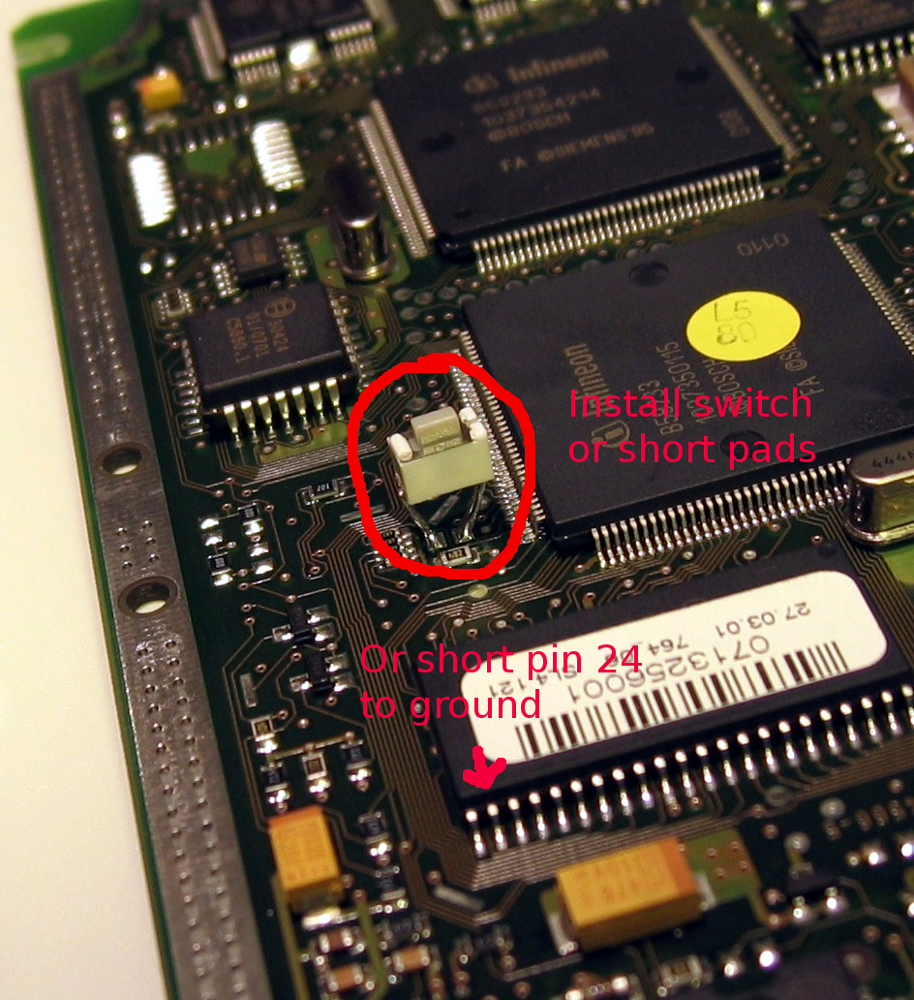
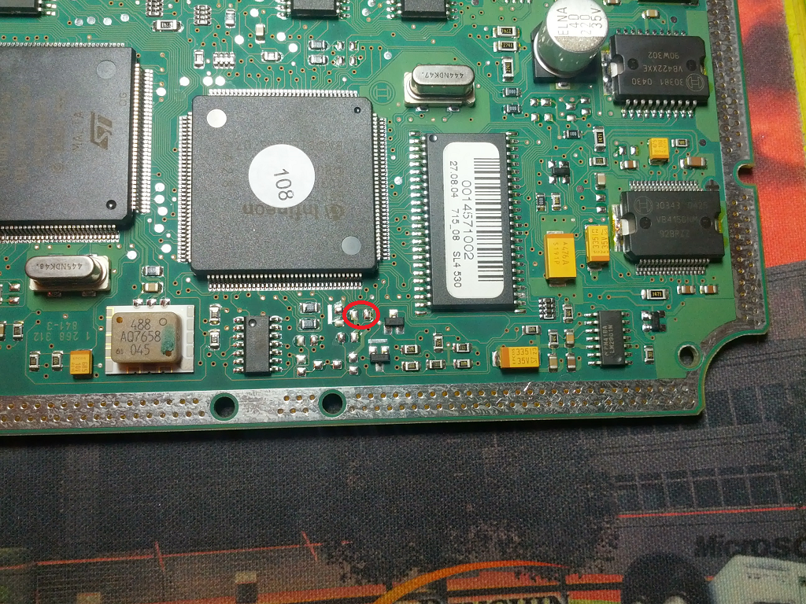

# Bootmode

Bootmode is a different protocol on the same K-line: the C167 bootstrap loader instead of KWP2000. Use it when KWP2000 will not start a session, after a failed entire-flash erase, or to read/write the physical EEPROM.

Connect setup and cables: [Getting started](getting-started.md). NAK / wrong ACK: [Troubleshooting](troubleshooting.md#bootmode-nak-or-wrong-ack).

Flash read/write uses the **Flashing** tab. The protocol combo at the top of the window must be **Boot Mode**. **KWP2000 Logging** is hidden in Boot Mode.

## When to use it

- KWP connect or programming session is dead
- Entire-flash erase left the ECU unable to boot
- Physical EEPROM dump or write (not the KWP EEPROM mirror)

Simos 3.x and EDC15 flash layout is auto-detected. EEPROM chip select on the **EEPROM** tab includes ME7.1, ME7.5, ME7.1.1, Simos 3.2, and EDC15 I2C.

## M5.9.2

M5.9.2 does not use Boot Mode. This screen is the C167 bootstrap loader. M5.9.2 is an 80C196 ECU, so it does not answer. The hello (`0x00` in, device ID back) is only a cable echo. No ID follows, at 9600 or at 38400.

Use **KWP2000**. Pin 43 selects which session the ECU answers.

- **Full Write** needs pin 43 at +12 V. It sends the loaded file on the first KWP2000 wake.
- **Full Read** needs pin 43 off +12 V. The held KWP1281 session copies `0x0000`-`0xBFFF` (49152 bytes). That is the calibration, not the whole flash.
- **Read EEPROM** uses that same read session and copies the 24C02. Pin 43 stays off +12 V.

### Write

Pin 43 stays at +12 V for the whole attempt. Set it before you apply power.

- Protocol **KWP2000**, connection method **Fast Init**. The connect-bar baud selects the speed byte.
- Connect. A good connect says `OK. Connect succeeded. First wake stayed KWP2000. Tester present is not sent.`
- **Full Write** sends the loaded file. Let it run. Tester present is not sent, and the app does not close this session on its own.
- **Read DTCs** and **Clear DTCs** need the read session, pin 43 off +12 V. They are blocked on the programming wake.

### If the write fails

[M5.9.2 write fails](troubleshooting.md#m592-write-fails).

Protocol detail is in [M5.9.2](../M5.9.2.md).

## Entry and power

Same ground and +12 V as a KWP bench. Bootmode needs the ECU in bootstrap, not a normal KWP session.

Ground flash pin 24, or short the boot pads, as ignition power comes up. Release it after 2-3 seconds. Leave it grounded while programming and the write fails. The CPU samples P0L.4 at power-up.

ME7.1 and ME7.5 have a pad pair for that net. Short the pads, or fit a switch across them.

ME7.1.1 boards differ. This one has a pad pair. On a board without them, ground flash pin 24. With the plugs to the right and the pin-1 mark at the top right of the flash, pin 24 is the second pin in from the left on the bottom edge.

Simos3 / EDC15 entry differs; use a pinout for that ECU.

The app reports **Put ECU in boot mode** if the handshake never starts.

If the loader core is already running (`0xAA`), the app uploads the flash driver and reads the flash type with `FC_GETSTATE`. A flash id from an earlier connect in this process is not reused. If that query fails, the app shows **Flash Type Not Detected** and flash read and write stay disabled. Disconnect, power-cycle to a full boot entry, and reconnect.

## Baud

Default **57600**. Try **38400** if 57600 fails (especially CH340).

M5.9.2 does not use this loader. The programming wake is pin 43 at +12 V for a write, and off +12 V for a read ([M5.9.2](#m592)).

9600 and 19200 can fail non-deterministically on CH340 (wrong ACKs, NAK, readback errors). Likely USB latency, buffering, jitter, or voltage — not baud error. Prefer FTDI at those lower rates. [Issue #44](https://github.com/NefMoto/NefMotoOpenSource/issues/44)

**124800** is for speed after you have verified it on that ECU and cable. Most reliable on the bench.

FTDI and CH340 are equivalent for KWP. Bootmode is where CH340 baud caveats belong.

## Connect

- Protocol: **Boot Mode**
- Device list, **Refresh Devices**
- Baud as above
- **Connect Boot Mode**

Then **KWP2000 Info** → **Read ECU Info** (device ID, CPU family, SYSCON / BUSCON / ADDRSEL, memory status).

## Flash

On **Flashing**, the layout combo is **disabled**. Layout comes from the flash device ID (`FC_GETSTATE`). Tooltip shows base address, size, and sector count when detection succeeded. A running core gets the same driver upload and `FC_GETSTATE` on every connect. A flash id from an earlier connect is not reused. If that query fails, the combo shows **Flash type not detected** and **Flash Type Not Detected** appears.

- **Full Read Flash** / **Full Write Flash**
- **Diff Read Flash** is not supported in bootmode (the loader has no checksum-for-range)
- **Verify Write** is forced off for bootmode flash write
- **Verify Read** is off in bootmode. A bootmode full read sends no `0xC5`
- Variant (ME7 vs Simos3 vs EDC15) is taken from the detected layout base (ME7 `0x800000`, Simos3/EDC15 `0x400000`). There is no separate variant dropdown.

**File > Choose Flash File** still loads a `.bin` for write.

After EEPROM access, the EEPROM driver has overwritten the flash driver at `0xF600`. Re-detect flash (disconnect / reconnect or **Read ECU Info**) before another flash read/write.

## Bootmode EEPROM

On the **EEPROM** tab. **Read EEPROM** reads the chip in bootmode, or through the KWP mirror over a KWP2000 connection. **Write EEPROM** needs a bootmode connection. **Read EEPROM Mirror** stays on **KWP2000 Info**; that is the KWP page at `0x6001E0`, not this chip.

### Read EEPROM over KWP2000

Connected with KWP2000 instead of bootmode, **Read EEPROM** reads a 95040 through the ECU. It uses the development session, like **Read EEPROM Mirror**, and reads the mirror at `0x600000` one 16-byte page at a time. No login is needed and nothing is written.

ME7.1.1 refuses pages 3 and 4 (SKC and cluster code) with `7F 23 12`. The read logs them as withheld and carries on. Then it reads RAM `0x380000-0x387FFF` and looks for the firmware's EEPROM shadow: one 16-byte slot per record id, in the high byte of the page descriptor. The base is where the most served pages match, and at least 4 must match. A withheld page is taken from its slot only when its own page checksum is valid.

Pages that still can't be read stay `FF` and the status log names them. **Save EEPROM File** keeps them as `FF`. **Write EEPROM** is disabled for an image with missing pages, because writing it would erase them on the chip.

Chip select:

- `ME7.1 P4.7`
- `ME7.5 P4.7`
- `ME7.1.1 P6.3`
- `Simos 3.2 P6.4`
- `EDC15 I2C` (no pin)

Device, for a SPI chip select. The default is `95040 SSC 512 B`.

- `95040` SSC or XSSC, 256 B or 512 B
- `95P08` SSC or XSSC, 1024 B. Same driver family as `95040`. Chip select is `ME7.1.1 P6.3`
- `95080` SSC or XSSC, 1024 B
- `95160` SSC or XSSC, 2048 B
- `95320` SSC or XSSC, 4096 B
- `93S46` SSC, 128 B
- `93S56` SSC, 256 B
- `93S66` SSC, 512 B
- `93S76` SSC, 1024 B
- `93S86` SSC, 2048 B

EDC15 replaces that list with `24C04 I2C 512 B` (the default) and `24C02 I2C 256 B`.

The grid is read-only, 16 bytes per row. With no image loaded it stays on screen as grey `00`s for the selected device size, and the legend stays grey. A `95040` 512-byte image shows 32 rows. The legend then shows the Immo, SKC, `P0602`, and Lockout values, then Checksum **ok** in green or **not ok** in red. The SKC is page 3 bytes 2-3 (`0x032`, copy at `0x042`), little-endian, shown as 5 decimal digits, or **unset** when the bytes are `FF FF`. The word at `0x014`/`0x024` next to the immo flag is an immobiliser state word the ECU writes itself, not the SKC. The ASCII column highlights the ECU part number at `0x1C2` (11 characters), both tool ID copies at `0x1E2` and `0x1F2` (6 characters), both VIN copies (`0xB5`–`0xB9` plus `0xD0`–`0xDB`, and `0xC5`–`0xC9` plus `0xE0`–`0xEB`), and both immobilizer IDs (`0xDC` plus `0xF0`–`0xFC`, and `0xEC` plus `0x100`–`0x10C`). Hover a highlighted character for the field name. A non-printable byte is `.`. Any other device size, including a `95P08` 1024-byte image, is plain hex, with a grey legend.

**Load EEPROM File** displays a file of the selected device size. **Read EEPROM** dumps the chip and shows it. It does not ask for confirmation. A bootmode read whose selected size is over 512 bytes checks the first 512 as a 95040. When those page checksums match, the status says the chip looks like a 95040 and names the selected device. When they do not match and page 0 byte 15 is not `0x5A`, the status says the size is unverified. **Save EEPROM File** writes the image on screen to a `.bin`. None of those program the chip.

**Write EEPROM** programs that image. It stays disabled until the image length matches the selected device. Immobilizer / VIN / adaptations can change. If data-page checksums are invalid on a `95040` 512-byte image:

- **Yes** — correct data-page checksums, then continue (pages 28–29 are left unchanged)
- **No** — write the image as-is
- **Cancel** — abort

**Immo Off** edits a `95040` 512-byte image or a `95P08` 1024-byte image on screen only. **Reset Lockout** and **Clear P0602** edit a `95040` 512-byte image only. On any other device they stay disabled. Each stays disabled when no image is loaded. **Reset Lockout** also stays disabled when the lockout bytes are already `00 00`. When immo is already off, that button reads **Immo On**. When bit 7 is already clear, that button reads **Set P0602**. The legend sits under the hex. Read, load, save, and edit results are lines in the status window. A line under the legend says a write is still pending. **Backup before write** starts on and is remembered in `preferences.json`. When it is on, a pending edit asks for a `.bin` of the image from before those edits. **Verify Write** applies.

- **Immo Off** on a `95040` sets `0x012` and `0x022` to `0x02`. Both copies must match. **Immo On** sets that pair to `0x01` when both are `0x02`. Page 1 and page 2 checksums are corrected.
- **Immo Off** on a `95P08` sets `0x012` and `0x022` to `0x02`. Both copies must match. **Immo On** sets that pair to `0x01` when both are `0x02`. Checksums are left unchanged, and the write dialog does not offer the `95040` checksum correction.
- **Reset Lockout** sets `0x1EC`–`0x1ED` and `0x1FC`–`0x1FD` to `00 00`. The `P0602` flag and counters stay. Page 30 and page 31 checksums are corrected when those bytes change. This is the lockout field.
- **Clear P0602** clears bit 7 at `0x1E8` and `0x1F8`. **Set P0602** sets that bit. Other bits, counters, and lockout bytes stay. Page 30 and page 31 checksums are corrected when those bytes change.

## Next

- [Flashing](flashing.md) — KWP layout, BT vs BB, RAM kernel after a KWP write
- [Troubleshooting](troubleshooting.md)
- [Getting started](getting-started.md)
