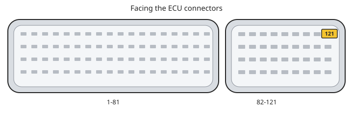

# Flashing

Flash read and write on the **Flashing** tab, for KWP2000 and bootmode. Connect first ([Getting started](getting-started.md)). Back up with a **read** before any write.

Physical EEPROM read/write is the **EEPROM** tab. See [Bootmode](bootmode.md).

If a write fails, see [Troubleshooting](troubleshooting.md).

## Layout

KWP has no flash chip ID. You pick the XML in the layout combo:

- `29F800BT` — 1MB, **top-boot** small-sector cluster
- `29F800BB` — 1MB, **bottom-boot**
- `29F800` — 1MB, sixteen 64KB sectors (no boot cluster)
- `29F400` / `29F400BB` / `29F400BT` — 512KB
- `29F200` / `29F200BB` — 256KB

BT vs BB is the same density with the small sectors at opposite ends. A write with the wrong orientation can program most of the chip, then fail on the boot cluster. That is **Wrong Flash Layout**, not “persistent data.” Recovery: [Wrong Flash Layout](troubleshooting.md#wrong-flash-layout).

Most ME7.x ECUs are **29F800BB** (1MB) or **29F400BB** (512KB).

M5.9.2 is typically **29F200** (256KB).

BT is rarely seen on Bosch ECUs.

## File

**File > Choose Flash File** loads a `.bin` (or any file). Size must match the selected layout. The path stays in the box on the Flashing tab.

**Verify Checksums** checks ME7 checksums in the loaded file. Connected in boot mode, it checksums each sector on the ECU. See [Bootmode](bootmode.md#flash). There is no separate Checksum tab. **Correct Checksums** is not on the tab.

## Read

- **Full Read Flash** — whole layout, checksummed as **Verify Read** sets (below), then saved. A boot-mode read sends no `0xC5`. A KWP read whose sector 0 is not 16 KB at `0x800000` also sends no checksum.
- **Diff Read Flash** — sectors that differ from the loaded file. On KWP the first sector is always uploaded. Later sectors are checksum skips when that checksum is served. A development checksum `0x22` uploads the remaining sectors in that session. Boot mode skips every matching sector, including the first.

A KWP read opens a development session from the default session, then logs in again. A refused login stays in that session and the upload probe is still sent. Programming opens once if the development session does not start, or if the probe returns `0x11`, `0x90`, or `0x33`. A general reject stays out of the programming kernel. Family exceptions are in [KWP2000](../KWP2000.md).

If the development checksum is not served, the read stays in that session and uploads every sector. It does not open programming, so it does not set the programming flag. A programming-session checksum that is not served, or a subfunction-not-supported reply, asks before the transfer changes. **OK** reads every sector. **Cancel** stops the read.

**Cancel Current Operation** during a KWP read waits for the current request, then clears the EEPROM bit behind `P0602` before it stops, and reports "Reading ECU flash memory cancelled." Cancel again to stop at once; that leaves the bit set, as does a cancel before the first sector finishes.

Engine off. Confirmation dialogs include the ME7.5 pin 121 hint when connected over KWP.

If addressable flash extends past the selected layout (512KB chip mirrored into 1MB, or a 1MB chip with a 512KB layout), NefMoto asks whether to check for a mirror:

- **Yes** — compare a sample at the start of the layout with the same offset above it
- **No** — continue with this layout
- **Cancel** — abort

A matching sample is strong evidence of mirroring, not proof of chip size. A mismatch usually means the layout is too small (try `29F800`). Example: [issue #80](https://github.com/NefMoto/NefMotoOpenSource/issues/80).

## Write

- **Full Write Flash** — every sector in the layout
- **Diff Write Flash** — sectors whose ECU checksum does not match the file. A full match skips every sector, does not erase, and leaves the connection open. A write that erases a sector still disconnects at the end.
- **Verify Write** — checked by default. On KWP, the written sector is read back. On boot mode, each programmed sector is checksummed on the ECU. A matching boot-mode sector is still skipped before erase
- **Verify Read** — checked by default. Checked, a bottom-boot KWP full read checksums every sector, and a bootmode read checksums each transferred sector. Unchecked, that KWP read checksums only sectors 0–3 and a bootmode read does not checksum. Disabled on KWP when sector 0 is not 16 KB at `0x800000`.

A KWP write opens a programming session from the default session. If that fails, nothing is erased. No upload in that session: layout probe skipped, Diff Write still tries sector checksums; unavailable/no-reply asks before erase (**Cancel** stops, **OK** writes every loaded sector). Failed erase-mode checks stay on sector erase.

A finished KWP write clears the programming flag (`P0602`): 2-byte upload+exit if the layout probe opened upload, else three matching checksums (ME7.1.1). Details: [P0602](clearing-P0602.md).

Confirmation requires: valid file and layout (BT vs BB must match the chip), engine not running, battery at least 12 V, adaptations will reset, the process can run uninterrupted.

**ME7.5 on the bench:** pin 121 must be at +12 V for KWP read/write. Facing the ECU connector, it is the top right pin on the small connector, on the same switched +12 V as pins 3, 21, and 62. Ident can succeed while a programming session fails if that pin is floating.



**M5.9.2:** pin 43 is the programming wake. Hold it at +12 V for a write, and off +12 V for a read. Set it before applying power. In the car the usual OBD pin is 13, bridged to pin 16. Steps: [M5.9.2](bootmode.md#m592).

### After a successful write

[Ident says RAM program after a write](troubleshooting.md#ident-says-ram-program-after-a-write).

### After an abort

Stay powered and retry. M5.9.2 power-cycles instead. [Ident says RAM program after a write](troubleshooting.md#ident-says-ram-program-after-a-write). [M5.9.2 write fails](troubleshooting.md#m592-write-fails). [Wrong Flash Layout](troubleshooting.md#wrong-flash-layout).

## Erase

There is no standalone erase button. Sectors are erased as part of a write.

**Sector Erase Failed** (Yes/No/Cancel) is persistent data on a sector that is **not** a BT/BB boot cluster:

- **Yes** — erase the entire flash and restart the write. If that write then fails, the ECU may not boot; recover with [Bootmode](bootmode.md).
- **No** — skip that sector and continue
- **Cancel** — abort

Do not use entire-flash erase to “fix” a BT/BB mismatch.

## Command line

Flash read and write use the same operations as this tab and print the same confirmation before connecting. `kwp info`, `kwp dtc read`, `kwp dtc clear`, `bootmode info`, `bootmode verify`, `bootmode reset`, and `bootmode immo off` connect without that prompt. The installer places `ecuflash.exe` in `C:\Program Files\NefMotoECUFlasher`, next to the memory layouts.

```text
ecuflash -h
ecuflash --help
ecuflash --version
ecuflash usb
ecuflash layouts
ecuflash --layout
ecuflash kwp info -o info.txt
ecuflash kwp dtc read -o dtcs.txt
ecuflash kwp dtc clear
ecuflash bootmode info -o boot.txt
ecuflash bootmode immo off
ecuflash bootmode immo off --95p08 -o backup.bin
ecuflash bootmode verify -i image.bin
ecuflash bootmode reset
ecuflash kwp read full --layout 29F800BB -o out.bin
ecuflash kwp read full --layout 512k -o out.bin
ecuflash kwp read full -o calibration.bin
ecuflash kwp read diff -i base.bin -o out.bin
ecuflash kwp write full -i image.bin
ecuflash kwp write diff -i image.bin
ecuflash bootmode read full -o out.bin
ecuflash bootmode read diff -i base.bin -o out.bin
ecuflash bootmode write full -i image.bin
ecuflash bootmode write diff -i image.bin
```

- No arguments, `-h`, and `-?` print the usage and exit. `--help` prints the command descriptions and options. `--version` prints the build version and exits. None of them connect.
- Product lines (`usb`, `layouts`, `info`, `dtc read`) go to **stdout**, or only to `-o` when that file is set. Errors, long-op progress (`%`), prompts, and verbose detail go to **stderr**. Default stderr is quiet except errors and progress.
- `-v` / `--verbose` (repeat as `-vv` / `-vvv`) adds stderr detail: USER, then LOG, then DEV. `-d` / `--debug` prints TRACE protocol traffic on stderr (independent of `-v`).
- `usb` prints each FTDI or CH340 device as index, type, description, and serial. It does not connect. `--usb N` selects that index. One attached device is used when `--usb` is omitted. On macOS, genuine FTDI uses the built-in driver (`/dev/cu.usbserial-*`) and CH340 needs WCH's DriverKit extension (`/dev/cu.wchusbserial*`). On Linux, the kernel drivers create `/dev/ttyUSB*` or `/dev/ttyACM*`; opening the node usually requires the `dialout` group.
- `layouts`, and `--layout` with no name, print each layout basename. They do not connect. Pass one of those names to `--layout`.
- `kwp info` reads ECU identification in the standard session, the same entries as **Read ECU Info**. Lines go to stdout; `-o` writes them to a file instead of stdout.
- `bootmode info` reads the boot-mode ECU information. The ECU must already be in boot mode. Lines go to stdout; `-o` writes them to a file instead of stdout. See [Bootmode](bootmode.md).
- `kwp dtc read` prints each diagnostic trouble code on stdout, the same list as **Read DTCs**. `-o` writes those lines to a file instead of stdout. `kwp dtc clear` clears that list, the same tester clear as **Clear DTCs**. It does not checksum the programming flag. A programming session must be left with an ignition cycle first. A held M5.9.2 session uses the KWP1281 fault list. See [Getting started](getting-started.md#logging-and-dtcs).
- `bootmode immo off` reads the physical EEPROM, sets the immo bytes, saves the image from before that edit, and writes the chip. On `07K906032B` that edit does not disable the immobilizer. That ECU's part is a `95160`, 2048 bytes, on P6.3, and Immo Off uses the same map window. See [Bootmode](bootmode.md). The ECU must already be in boot mode. The default preset is `95040` SSC, 512 bytes, chip select P4.7 (ME7.1 and ME7.5). `--95p08` still selects `95P08` SSC, 1024 bytes, chip select P6.3. The bytes at `0x012` and `0x022` must match. They are set to `0x02`. On a `95040`, a `95P08`, or a `95160`, page 1 and page 2 checksums are corrected. The default backup names are `eeprom-95040-before-immo.bin` and `eeprom-95p08-before-immo.bin`. `-o` chooses that file. An existing file is left in place and the chip is not written. The write is verified unless `--no-verify` is set. If immo is already off, the chip is not written. See [Bootmode](bootmode.md).
- `-i` is the image to write, or the file a diff read or `bootmode verify` compares. `-o` is the file a read saves, the info or DTC lines, or the immo-off backup.
- `--layout` is a basename from [Layout](#layout), or `1m`/`1mb` (`29F800BB`), `512k`/`512kb` (`29F400BB`), or `256k`/`256kb` (`29F200`). Case does not matter. When `-i` is present and `--layout` is omitted, those same three sizes are selected from the file length. Any other length asks for `--layout`. A full KWP read with no `--layout` copies `0x0000`-`0xBFFF` on a held M5.9.2 session (pin 43 off +12 V). That is the calibration, not the whole flash. Any other ECU still needs `--layout`. `29F800BB` is not assumed. The image length must match the layout before a write starts.
- KWP uses fast init. `--slow` uses slow init. `--baud` sets the session baud. The default list is 124800, 52800, 38400, 10400, 9600.
- Boot mode defaults to 57600. The ECU must already be in boot mode. See [Bootmode](bootmode.md). Diff read and diff write checksum each sector on the ECU. Boot mode reads the chip id and builds the layout. A boot-mode write checksums each programmed sector unless `--no-verify` is set. `bootmode verify -i` checksums each sector against that file. `bootmode reset` sends command `0x32` and closes the port. See [Bootmode](bootmode.md#flash).
- `--no-verify` matches clearing **Verify Read** or **Verify Write**. On a full KWP read of a bottom-boot layout whose first sector is 16 KB at `0x800000`, that checksums the first four sectors instead of every sector.
- Press Enter to continue. Ctrl-C aborts. `-f` and `--force` answer the confirmation prompts and do not wait. On **Sector Erase Failed** they stop the write. They do not erase the entire flash. A mirror question runs the sample check. A cancelled write does not connect.
- There is no erase command. A write erases sectors as part of the write.

## Next

- [Bootmode](bootmode.md)
- [P0602](clearing-P0602.md)
- [Troubleshooting](troubleshooting.md)
- [Getting started](getting-started.md)
