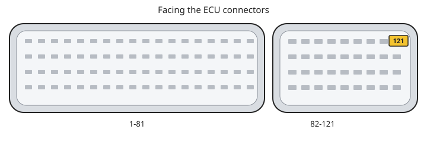

# Flashing

Flash read and write on the **Flashing** tab, for KWP2000 and bootmode. Connect first ([Getting started](getting-started.md)). Back up with a **read** before any write.

Physical EEPROM read/write is the **EEPROM** tab. See [Bootmode](bootmode.md).

If a write fails, see [Troubleshooting](troubleshooting.md).

## Layout

KWP has no flash chip ID. You pick the XML in the layout combo:

- `29F800BT` — 1MB, **top-boot** small-sector cluster
- `29F800BB` — 1MB, **bottom-boot**
- `29F800` — 1MB, sixteen 64KB sectors (no boot cluster)
- `29F400` / `29F400BB` / `29F400BT` — 512KB
- `29F200` / `29F200BB` — 256KB

BT vs BB is the same density with the small sectors at opposite ends. A write with the wrong orientation can program most of the chip, then fail on the boot cluster. That is **Wrong Flash Layout**, not “persistent data.” Recovery: [Wrong Flash Layout](troubleshooting.md#wrong-flash-layout).

Most ME7.x ECUs are **29F800BB** (1MB) or **29F400BB** (512KB).

M5.9.2 is typically **29F200** (256KB).

BT is rarely seen on Bosch ECUs.

## File

**File > Choose Flash File** loads a `.bin` (or any file). Size must match the selected layout. The path stays in the box on the Flashing tab.

**Verify Checksums** checks ME7 checksums in the loaded file. There is no separate Checksum tab. **Correct Checksums** is not on the tab.

## Read

- **Full Read Flash** — whole layout, checksummed as **Verify Read** sets (below), then saved. Bootmode and layouts whose sector 0 is not 16 KB at `0x800000` upload with no checksum.
- **Diff Read Flash** — sectors that differ from the loaded file. The first sector is always uploaded. Later matching sectors are checksum skips.

**Cancel Current Operation** during a KWP read waits for the current request, then clears the EEPROM bit behind `P0602` before it stops, and reports "Reading ECU flash memory cancelled." Cancel again to stop at once; that leaves the bit set, as does a cancel before the first sector finishes.

Engine off. Confirmation dialogs include the ME7.5 pin 121 hint when connected over KWP.

If addressable flash extends past the selected layout (512KB chip mirrored into 1MB, or a 1MB chip with a 512KB layout), NefMoto asks whether to check for a mirror:

- **Yes** — compare a sample at the start of the layout with the same offset above it
- **No** — continue with this layout
- **Cancel** — abort

A matching sample is strong evidence of mirroring, not proof of chip size. A mismatch usually means the layout is too small (try `29F800`). Example: [issue #80](https://github.com/NefMoto/NefMotoOpenSource/issues/80).

## Write

- **Full Write Flash** — every sector in the layout
- **Diff Write Flash** — sectors whose ECU checksum does not match the file. A full match skips every sector, does not erase, and leaves the connection open. A write that erases a sector still disconnects at the end.
- **Verify Write** — checked by default on KWP (read-back after program)
- **Verify Read** — checked by default. Checked, a bottom-boot KWP full read checksums every sector. Unchecked, that read checksums only sectors 0–3. Disabled in bootmode and when sector 0 is not 16 KB at `0x800000`.

A KWP write that finishes (full or diff) ends with a 2-byte upload at the start of flash and three checksums of a sector that matches the file. That clears the EEPROM bit behind `P0602` ([P0602](clearing-P0602.md)).

Confirmation requires: valid file and layout (BT vs BB must match the chip), engine not running, battery at least 12 V, adaptations will reset, the process can run uninterrupted.

**ME7.5 on the bench:** pin 121 must be at +12 V for KWP read/write. Facing the ECU connector, it is the top right pin on the small connector, on the same switched +12 V as pins 3, 21, and 62. Ident can succeed while a programming session fails if that pin is floating.

**M5.9.2:** pin 43 is the programming wake. Hold it at +12 V for a write, and off +12 V for a read. Set it before applying power. In the car the usual OBD pin is 13, bridged to pin 16. Steps: [M5.9.2](bootmode.md#m592).

### After a successful write

[Ident says RAM program after a write](troubleshooting.md#ident-says-ram-program-after-a-write).

### After an abort

Stay powered and retry. M5.9.2 power-cycles instead. [Ident says RAM program after a write](troubleshooting.md#ident-says-ram-program-after-a-write). [M5.9.2 write fails](troubleshooting.md#m592-write-fails). [Wrong Flash Layout](troubleshooting.md#wrong-flash-layout).

## Erase

There is no standalone erase button. Sectors are erased as part of a write.

**Sector Erase Failed** (Yes/No/Cancel) is persistent data on a sector that is **not** a BT/BB boot cluster:

- **Yes** — erase the entire flash and restart the write. If that write then fails, the ECU may not boot; recover with [Bootmode](bootmode.md).
- **No** — skip that sector and continue
- **Cancel** — abort

Do not use entire-flash erase to “fix” a BT/BB mismatch.

## Next

- [Bootmode](bootmode.md)
- [P0602](clearing-P0602.md)
- [Troubleshooting](troubleshooting.md)
- [Getting started](getting-started.md)
