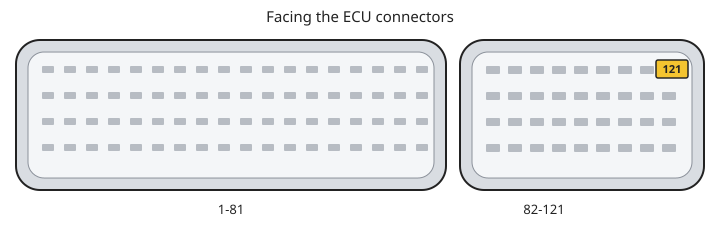

# Getting started

Install, connect a cable, and open a first KWP2000 session. Do not write flash until you have a backup of the ECU. [Flashing](flashing.md), [README Limitations](../../README.md#limitations).

If connect fails, see [Troubleshooting](troubleshooting.md).

## Install

- Download the MSI from the [latest GitHub release](https://github.com/NefMoto/NefMotoOpenSource/releases/latest).
- The installer is 64-bit and goes to `C:\Program Files\NefMotoECUFlasher`. An older 32-bit install under Program Files (x86) should be replaced on upgrade.
- The MSI checks for the [.NET 10 Desktop Runtime (x64)](https://aka.ms/dotnet/10.0/windowsdesktop-runtime-win-x64.exe). The SDK, console runtime, ASP.NET runtime, and .NET 8 Desktop runtime are not enough. The runtime is not bundled in the MSI.
- Windows only. Device listing uses WMI (needed for CH340 detection).

To build from source instead, see [BUILDING.md](../BUILDING.md).

## Update check

At startup the app checks for a newer release. If one exists, a window shows the release notes.

- **Download MSI** opens the installer in your browser. You install it yourself.
- **View Latest Release** opens the release page.
- **Help → Check for Updates...** checks now.
- **Help → Check for Updates at Startup** turns the startup check on or off.

## Cable

You need **either**:

- A dumb-mode K+DCAN or KKL cable: USB-to-serial with an FTDI or CH340 chipset, K-line pass-through to the ECU (no protocol translation), **or**
- A legacy Ross-Tech HEX-USB or HEX-USB+CAN with Ross-Tech VCP drivers, dumb K-line pass-through, and smart mode disabled — the interface must show up in NefMoto's device list (install VCP per [Ross-Tech](http://www.ross-tech.com/vag-com/usb/virtual-com-port.php) if it does not)

> [!WARNING]
> Ross-Tech HEX-V2 and HEX-NET are not supported. They lack dumb K-line pass-through. Do not use KII-USB. Its pass-through is poor.

FTDI and CH340 are equivalent for KWP2000. Some clone cables fail slow init on either chipset; that is a cable/driver problem, not “CH340 cannot do 5-baud.” Enable **Slow init timing log** on the **KWP2000 Settings** tab when diagnosing connect issues. Bootmode baud caveats for CH340: [Bootmode](bootmode.md#baud).

Shopping: any cable that is a USB serial adapter plus a dumb K-line transceiver. No vendor endorsement here.

Many cheap cables labeled **KWP2000** are FTDI clones. The FTDI drivers that ship with Windows blacklist those chips, so they never show up as a working COM port and will not work with NefMoto. Use a genuine FTDI adapter or a CH340 cable instead.

## First launch

The connection controls are at the **top of the window**, not on a tab.

- Protocol combo: **KWP2000** or **Boot Mode** (brick recovery and physical EEPROM — [Bootmode](bootmode.md)).
- Baud: leave **10400** for KWP unless you already know another rate.
- Device list: pick the USB serial adapter. **Refresh Devices** if it is missing.
- Connection method: **Slow Init** (default) or **Fast Init**.
- **Connect Slow Init** / **Connect Fast Init** (the button label follows the method).

Tabs after you are connected:

- **KWP2000 Info** — ident and DTCs (**Read ECU Info**, **Read DTCs**, **Read EEPROM Mirror**, **Clear DTCs**)
- **Flashing** — KWP2000 and bootmode read/write ([Flashing](flashing.md))
- **EEPROM** — physical EEPROM read/write. Immo off on a 95040 or 95P08 image. Lockout reset and clear `P0602` on a 95040 image ([Bootmode](bootmode.md)). Over KWP2000, **Read EEPROM** reads the chip through the mirror at `0x600000` ([Read EEPROM over KWP2000](bootmode.md#read-eeprom-over-kwp2000)).
- **KWP2000 Logging** — live variables. It is not [ME7Logger](https://nefariousmotorsports.com/forum/). Hidden when the protocol combo is **Boot Mode**.

### Options if you have issues or are a developer

- **KWP2000 Settings** — address, timings, **Verify cable in dumb mode**, **Slow init timing log**

## Logging and DTCs

**KWP2000 Info:** **Read DTCs**, **Read EEPROM Mirror**, **Clear DTCs**, save/load a DTCs file. Those three buttons stay disabled in a programming session. **Read EEPROM Mirror** reports the page at `0x6001E0` and does not clear anything. For `P0602` or `P1681`, see [P0602](clearing-P0602.md).

**KWP2000 Logging:** live variables while KWP2000 is connected. This is not [ME7Logger](https://nefariousmotorsports.com/forum/). After a flash write, logging stays broken until a complete power cycle ([Ident says RAM program after a write](troubleshooting.md#ident-says-ram-program-after-a-write)).

## Connect with slow init

Slow init is the default. Use it on the bench and in the car unless you already know fast init works on that ECU.

- Wait **at least 2.6 seconds** after a failed attempt before clicking Connect again. The ECU needs that idle time between slow inits.
- In the car, K-line often goes through the cluster. That is slower and less predictable than a direct bench wire. A miss of the address complement is a handshake miss, not a CH340 5-baud failure.
- **Verify cable in dumb mode** is on by default. A failure there usually means the adapter is not in dumb pass-through, or TX/RX echo is wrong.

Slow init and fast init both work with FTDI and CH340. Other flash images differ. There is no automatic fallback from fast to slow.

Every KWP connect logs the ECU part number when the ECU reports it. A KWP1281 exchange logs it as `KWP1281 connect info:`. Otherwise the tool asks for the KWP2000 identification fields right after connect and logs lines such as `ECU Vehicle Manufacturer Spare Part Number: ...`, without changing session or baud. An ECU that refuses that request stays connected.

## Fast init

Use **Fast Init** only when you already know it is reliable on that ECU and cable. It is much quicker. If it fails, switch to **Slow Init** and wait 2.6 seconds.

ECUs differ in which address they answer during fast init. Fast init tries one address per connection attempt, and the status log shows each one (`Connecting to address 0x..`). An ECU that ignores the first address connects on a later attempt, a few seconds later. Leave **Connect address** at the default and **Attempts** (Settings tab) at 3 or more. See [KWP2000.md](../KWP2000.md).

## Settings that persist

Saved in `preferences.json` next to the log file:

- Protocol, KWP baud, **Slow Init** / **Fast Init**, **Slow init timing log**
- Bootmode EEPROM **Backup before write**
- **Check for Updates at Startup** and the time of the last startup check

Not saved (reset when you restart the app):

- Connect address, timings, security options, number of connection attempts

**Restore To Defaults** on the Settings tab resets that tab only. It does not change the connect-bar init method or baud. You must be disconnected to use it.

## Bench vs in the car

**In the car:** ignition on as required by the car; engine usually off for programming. Expect cluster traffic on K-line. Prefer slow init. Patience on retries.

On older ME7.1, slow init at `0x01` answers KWP1281 twice. Connect then uses `0x11` and requests the baud on the connect bar (124800 on a fresh install). That opens a programming session, so **Read DTCs** stays off until an ignition cycle. The status line is `Switching to 124800 baud.` A second `0x01` that is already KWP2000 stays at 10400 until a read or write. A first `0x01` that is already KWP2000 does the same when calibration ident `1A 9B` does not contain `M5.9` ([M5.9.2](../M5.9.2.md)). Leave the baud box at 10400 and that `0x11` connect stays at 10400 too.

**On the bench:** direct K-line to the ECU, stable ground and +12 V, adapter in dumb mode.

Typical ME7 K-line is ECU pin 43, which is OBD pin 7. That is not the M5.9.2 programming-wake pin. Confirm against a pinout for your connector.

**ME7.5 on the bench:** for KWP read/write, pin 121 must be at +12 V. Facing the ECU connector, it is the top right pin on the small connector, on the same switched +12 V as pins 3, 21, and 62. The app prints this hint when it matters. A connect that works for ident can still fail a programming session if that pin is floating.

Bootmode uses the same power rails and a different entry pin (often pin 24 on ME7). See [Bootmode](bootmode.md).

## After you connect

Recommended first action: **KWP2000 Info** → **Read ECU Info**. Optionally **Read DTCs**. That confirms the session without touching flash.

A first flash action should be a **read** (backup), not a write. Layout selection, BT vs BB, and write recovery: [Flashing](flashing.md) and [Wrong Flash Layout](troubleshooting.md#wrong-flash-layout).

After a KWP write, see [Ident says RAM program after a write](troubleshooting.md#ident-says-ram-program-after-a-write).

## Log file

Session log:

`%AppData%\Nefarious Motorsports\NefMoto VW Audi ME7 Flasher Logger\NefMoto.log`

`%AppData%` is the **roaming** profile folder (`C:\Users\<you>\AppData\Roaming` on current Windows, not `AppData\Local`).

`preferences.json` is in the same folder. Use **Help → App Log → Open App Log** or **Open App Log Location** when reporting connect or flash problems. That file is not a data log.

## Next

- [Flashing](flashing.md)
- [Bootmode](bootmode.md)
- [Troubleshooting](troubleshooting.md)
- [README](../../README.md) — features, limitations, requirements
- [KWP2000.md](../KWP2000.md) — developer notes
